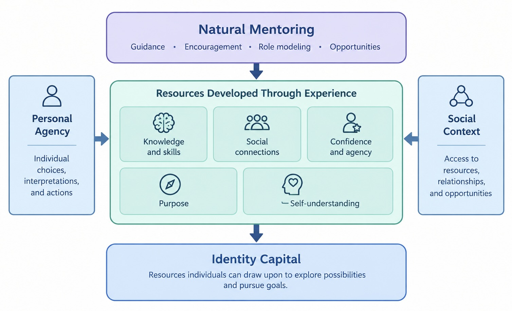

Identity development is shaped by personal experiences, social relationships, and access to opportunities. The Identity Capital Model and natural mentoring offer complementary perspectives on this process. Together, they help explain how relationships may contribute to the resources people develop and use as they navigate college, explore their identities, and consider their futures.connecting

For an overview of each concept, visit the [Identity Capital](/identitycapital.qmd){.fs-5} and [Natural Mentoring](/naturalmentoring.qmd){.fs-5} pages.

## How Natural Mentoring Connects to Identity Capital

Natural mentoring may contribute to identity capital by helping individuals develop resources through their relationships and experiences. These resources can include practical knowledge, skills, professional connections, confidence, and a clearer understanding of personal interests and goals. For example, a student who develops a supportive relationship with a professor may learn about research opportunities, receive guidance on entering the field, and connect with other researchers. These experiences can build practical skills and professional connections while helping the student evaluate whether research aligns with their interests and future plans. In this example, natural mentoring helps explain how support and opportunities emerge through relationships, while identity capital provides a framework for understanding the resources the student develops through those experiences.

## A Conceptual Model of Natural Mentoring and Identity Capital

The model in Figure 1 illustrates a proposed connection between natural mentoring and identity capital. Natural mentoring can provide guidance, encouragement, role modeling, and access to opportunities. Through these experiences, individuals may develop knowledge and skills, social connections, confidence, agency, purpose, and self-understanding. Personal agency and social context influence this process. Individuals interpret experiences and decide how to use the resources available to them, while their environments shape access to relationships and opportunities.

The model represents a proposed conceptual synthesis of the two framework models. Further research is needed to determine how natural mentoring directly contributes to identity capital development. 

## Reflection: Applying These Concepts to Your Development

Think about a relationship or experience that influenced how you understood yourself or considered your future.

1. Who has helped you see a strength, interest, or possibility in yourself that you might not have recognized otherwise?
2. What have you gained through this relationship? Consider knowledge, skills, confidence, a clearer sense of purpose, or connections to people and opportunities.
3. Has this person introduced you to an opportunity or future path you had not previously considered? How did that influence your thinking?
4. Was there advice or an opportunity you chose to pursue, adapt, or decline? What influenced your decision?
5. What resources would help you reach a current or future goal, and what people or experiences might help you develop them?
6. Reflecting on these questions can help you recognize how relationships and experiences have contributed to your development and identify resources that may help you move forward.

